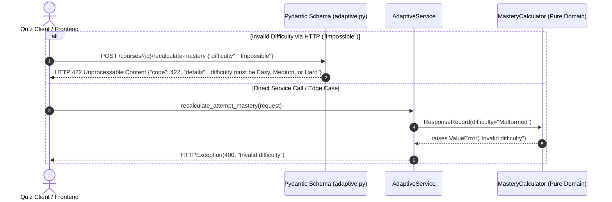
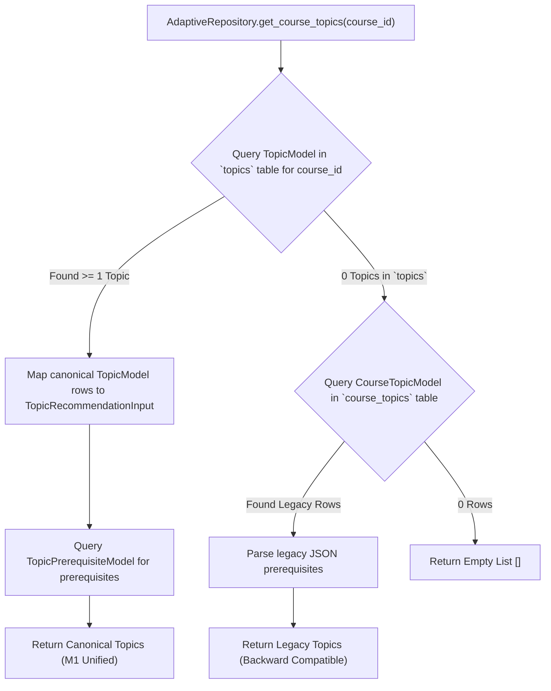

# AdaptLearn: Cross-Module Integration Gap Resolution Plan (GAP-02 & GAP-03)

> **Document Status**: Official Architectural Resolution & Collaboration Proposal  
> **Author & Lead**: Hiba Zulfiqar (`2023246`) — Module 1 (User & Course Management) & Module 4 (Personalized Learning Paths) Lead  
> **Collaborating Stakeholder**: Toqeer Ahmed (`2023567`) — Module 3 (Adaptive Engine) & Module 5 (Progress & Analytics) Lead  
> **Reviewed Stakeholder**: Mustajaab Ul Fida Qadri (`2023728`) — Module 2 (Quiz & Assessment) Lead  
> **Audit Reference**: `docs/sqa/CROSS_MODULE_INTEGRATION_REPORT.md`  
> **Current Git Branch**: `feature/m1-course-management` (Base commit: `fb4d3c5`)  
> **Date**: November 22, 2026  
> **Standard Compliance**: IEEE Std 1012-2016 (*Verification & Validation*) / IEEE Std 1044-2009 (*Anomaly Classification*)  

---

## 1. Executive Summary

During the comprehensive cross-module integration audit (`CROSS_MODULE_INTEGRATION_REPORT.md`), two significant architectural anomalies were diagnosed at the module boundaries:

1. **GAP-02 (Invalid Difficulty Validation)**: The attempt response schema in Module 3 accepts arbitrary strings for `difficulty`, deferring validation to the domain engine where an unhandled `ValueError` crashes the request with an **HTTP 500 Internal Server Error** instead of returning an HTTP 422/400 validation error.
2. **GAP-03 (Topic Catalog Harmonization)**: Module 1 persists curriculum topics in the canonical `topics` table (`TopicModel`), whereas Module 3 recommendations and Module 5 progress/analytics query a separate, isolated `course_topics` table (`CourseTopicModel`). Consequently, courses created through live M1 APIs appear with 0 topics and 0% progress in M5 dashboards.

This document presents a **forensic root-cause analysis**, **exact code citations**, **architectural design changes**, **collaborative ownership boundaries**, and a **phased implementation roadmap** that resolves both gaps with **zero regressions** to the existing 235 passing tests.

---

## 2. Forensic Root-Cause Analysis

### 2.1 GAP-02 — Invalid Difficulty Validation

#### Verified Defect Trace
```
HTTP Client Request (difficulty="Impossible")
        │
        ▼
backend/app/schemas/adaptive.py::AttemptResponseItem
        │  [DEFECT]: Declared as raw `difficulty: str` with ZERO constraints.
        ▼
backend/app/api/v1/endpoints/adaptive.py::recalculate_attempt_mastery
        │  Pydantic deserialization passes because "Impossible" is a valid string.
        ▼
backend/app/services/adaptive_service.py::recalculate_attempt_mastery
        │  Calls `ResponseRecord(is_correct=..., difficulty=item.difficulty)`
        ▼
backend/app/engine/mastery_calculator.py::ResponseRecord.__post_init__
        │  Executes: normalized = self.difficulty.strip().capitalize()
        │  Checks: if normalized not in frozenset({"Easy", "Medium", "Hard"}):
        │  Raises: ValueError("Invalid difficulty: 'Impossible'...")
        ▼
[UNHANDLED EXCEPTION]: Service layer has no `try...except ValueError` block.
        ▼
HTTP 500 Internal Server Error returned to client (FastAPI unhandled exception).
```

#### Detailed Code Evidence
- In `backend/app/schemas/adaptive.py` (lines 52–57):
  ```python
  class AttemptResponseItem(BaseModel):
      """An individual question response in a submitted attempt."""
      question_id: int
      topic_id: int
      difficulty: str  # <--- Missing Literal/Enum/Validator
      is_correct: bool
  ```
- In `backend/app/engine/mastery_calculator.py` (lines 52–60):
  ```python
  def __post_init__(self) -> None:
      normalized = self.difficulty.strip().capitalize()
      if normalized not in VALID_DIFFICULTIES:
          raise ValueError(
              f"Invalid difficulty: '{self.difficulty}'. "
              f"Must be one of {sorted(VALID_DIFFICULTIES)}"
          )
      object.__setattr__(self, "difficulty", normalized)
  ```
- In `backend/app/services/adaptive_service.py` (lines 162–172):
  ```python
  for item in request.responses:
      record = ResponseRecord(
          is_correct=item.is_correct,
          difficulty=item.difficulty,
          topic_id=item.topic_id,
      )  # <--- Unhandled ValueError raised here
      self.repository.append_student_response(...)
  ```

#### Correct Validation Boundary & HTTP Status Analysis
- **API Boundary (Pydantic Schema)**: In RESTful API design and FastAPI conventions, syntactic and field-level validation belongs in the schema layer. When an input payload field contains an unsupported value, FastAPI's `RequestValidationError` handler returns **HTTP 422 Unprocessable Content**.
- **Service Layer (Defense-in-Depth)**: If programmatic callers or internal background tasks invoke `AdaptiveService` directly, the service layer must catch domain `ValueError` and raise `HTTPException(status_code=400, detail=str(e))`.
- **Conclusion**: Invalid difficulty payloads submitted to `POST /courses/{id}/recalculate-mastery` must produce **HTTP 422** via schema validation. Service-level domain rejections must produce **HTTP 400**. Both eliminate the current HTTP 500 server crash.

---

### 2.2 GAP-03 — Topic Catalog Harmonization

#### Verified Defect Trace
```
                    INSTRUCTOR CREATES TOPIC
                               │
                               ▼
        M1: POST /api/v1/courses/{id}/topics
                               │
                               ▼
            CourseRepository.create_topic()
                               │
                               ▼
               SQL Table: `topics` (TopicModel)
                   (id, course_id, title, order_index)
                               │
               ┌───────────────┴───────────────┐
               ▼                               ▼
    M1 Topic Queries              M3 & M5 Service Queries
    ----------------              -----------------------
    GET /courses/{id}/topics      GET /courses/{id}/recommendations
    (Reads `topics` table)        GET /courses/{id}/progress
                                  GET /courses/{id}/analytics/*
                                               │
                                               ▼
                                  AdaptiveRepository.get_course_topics()
                                               │
                                               ▼
                                  SQL Table: `course_topics` (CourseTopicModel)
                                  [EMPTY! 0 rows for new course]
                                               │
                                               ▼
                                  Dashboard shows 0 topics, 0% completion!
```

#### Detailed Code Evidence
- **M1 Model** (`backend/app/models/course.py`, lines 58–84):
  `TopicModel` defines the authoritative relational curriculum entity mapping to `__tablename__ = "topics"`.
- **M1 Prerequisites** (`backend/app/models/course.py`, lines 145–175):
  `TopicPrerequisiteModel` defines foreign-key relational edges mapping to `__tablename__ = "topic_prerequisites"`.
- **M3 Legacy Model** (`backend/app/models/adaptive.py`, lines 33–44):
  `CourseTopicModel` maps to `__tablename__ = "course_topics"`, storing denormalized JSON strings (`prerequisites_json = Column(Text, default="[]")`).
- **M3 Repository Access** (`backend/app/repositories/adaptive_repository.py`, lines 97–118):
  `AdaptiveRepository.get_course_topics(course_id)` reads exclusively from `CourseTopicModel`. It has no knowledge of `TopicModel`.
- **M5 Progress Dashboard** (`backend/app/services/progress_service.py`, lines 53–54):
  ```python
  raw_topics = self.adaptive_repo.get_course_topics(course_id)
  # raw_topics is empty -> topic_breakdown = [], completion_percentage = 0.0%
  ```
- **M5 Instructor Analytics** (`backend/app/services/analytics_service.py`, lines 46, 95):
  ```python
  topics = self.adaptive_repo.get_course_topics(course_id)
  # topics is empty -> mastery distribution has 0 topic rows
  ```
- **M4 Proper Implementation** (`scratch/m4/learning_path_service.py`, lines 130–131):
  ```python
  # M4 correctly queries M1's canonical repository:
  topics = self.course_repo.list_course_topics(course_id)
  ```

#### Authoritative Model Identification
- `TopicModel` (`topics` table) is the **authoritative, normalized curriculum entity**. It enforces foreign key constraints against `courses.id`, sequential ordering index uniqueness, and relational prerequisite edges.
- `CourseTopicModel` (`course_topics` table) was an **interim testing scaffold** created in Milestone 2 prior to Module 1 delivery.

---

## 3. Exact Affected Files, Classes, and Methods

| Gap | Component | File Path | Class / Function | Modification Required |
| :---: | :--- | :--- | :--- | :--- |
| **GAP-02** | Schema | `backend/app/schemas/adaptive.py` | `AttemptResponseItem` | Add Pydantic `@field_validator` or `Literal["Easy", "Medium", "Hard"]` for `difficulty`. |
| **GAP-02** | Service | `backend/app/services/adaptive_service.py` | `AdaptiveService.recalculate_attempt_mastery` | Wrap response loop in `try...except ValueError` raising `HTTPException(400)`. |
| **GAP-02** | Endpoint | `backend/app/api/v1/endpoints/adaptive.py` | `recalculate_attempt_mastery` | Update docstring and OpenAPI schema error response documentation. |
| **GAP-03** | Repository | `backend/app/repositories/adaptive_repository.py` | `AdaptiveRepository.get_course_topics` | Query canonical `TopicModel` (`topics` table); fall back to `CourseTopicModel` if empty. |
| **GAP-03** | Repository | `backend/app/repositories/adaptive_repository.py` | `AdaptiveRepository.get_course_prerequisites` | Query canonical `TopicPrerequisiteModel`; fall back to `CourseTopicModel` if empty. |
| **GAP-03** | Service | `backend/app/services/progress_service.py` | `ProgressService.get_student_progress` | Ensure topic name and ordering reflect canonical `TopicModel`. |
| **GAP-03** | Service | `backend/app/services/analytics_service.py` | `AnalyticsService.get_mastery_distribution`<br>`AnalyticsService.get_student_roster` | Iterate over canonical course topics. |

---

## 4. Proposed Architecture and Data-Flow Changes

### 4.1 GAP-02: Schema Normalization & Exception Shielding



#### Proposed Code Specification
1. In `backend/app/schemas/adaptive.py`:
   ```python
   from pydantic import BaseModel, Field, field_validator

   VALID_DIFFICULTIES: frozenset[str] = frozenset({"Easy", "Medium", "Hard"})

   class AttemptResponseItem(BaseModel):
       """An individual question response in a submitted attempt."""
       question_id: int = Field(..., ge=1, description="Question identifier")
       topic_id: int = Field(..., ge=1, description="Topic identifier")
       difficulty: str = Field(..., description="Question difficulty: 'Easy', 'Medium', or 'Hard'")
       is_correct: bool = Field(..., description="Whether the answer was correct")

       @field_validator("difficulty")
       @classmethod
       def validate_difficulty(cls, v: str) -> str:
           normalized = v.strip().capitalize()
           if normalized not in VALID_DIFFICULTIES:
               raise ValueError(f"Difficulty must be one of {sorted(VALID_DIFFICULTIES)}, got '{v}'")
           return normalized
   ```
2. In `backend/app/services/adaptive_service.py`:
   ```python
   try:
       record = ResponseRecord(
           is_correct=item.is_correct,
           difficulty=item.difficulty,
           topic_id=item.topic_id,
       )
   except ValueError as e:
       raise HTTPException(
           status_code=status.HTTP_400_BAD_REQUEST,
           detail=str(e),
       ) from e
   ```

---

### 4.2 GAP-03: Dual-Source Repository Fallback Pattern

To guarantee **100% backward compatibility** with legacy fixtures in `test_adaptive_api.py`, `test_progress_api.py`, and `test_instructor_analytics_api.py` (which call `a_repo.set_course_topics(...)`), `AdaptiveRepository` will adopt the proven **Dual-Source Fallback Pattern** established in `ProgressRepository` under Decision D7/D8:



#### Proposed Code Specification in `backend/app/repositories/adaptive_repository.py`
```python
from app.models.course import TopicModel, TopicPrerequisiteModel
from app.models.adaptive import CourseTopicModel

def get_course_topics(self, course_id: int) -> list[TopicRecommendationInput]:
    """Retrieve all topic candidates for a course.
    
    Dual-Source Resolution:
    1. Primary: Queries canonical `topics` table (M1 TopicModel).
    2. Fallback: Queries legacy `course_topics` table for backward compatibility.
    """
    with self.session_factory() as session:
        # Primary: Check canonical M1 topics table
        m1_topics = (
            session.query(TopicModel)
            .filter_by(course_id=course_id, is_active=True)
            .order_by(TopicModel.order_index.asc(), TopicModel.id.asc())
            .all()
        )
        if m1_topics:
            # Query prerequisites for these topics
            topic_ids = [t.id for t in m1_topics]
            prereq_rows = (
                session.query(TopicPrerequisiteModel)
                .filter(TopicPrerequisiteModel.topic_id.in_(topic_ids))
                .all()
            )
            prereq_map: dict[int, list[int]] = {tid: [] for tid in topic_ids}
            for p in prereq_rows:
                prereq_map[p.topic_id].append(p.prerequisite_topic_id)

            return [
                TopicRecommendationInput(
                    topic_id=t.id,
                    name=t.title,
                    mastery_level="Not Assessed",
                    score=0.0,
                    prerequisites=tuple(sorted(prereq_map.get(t.id, []))),
                )
                for t in m1_topics
            ]

        # Fallback: Check legacy course_topics table
        legacy_rows = (
            session.query(CourseTopicModel)
            .filter_by(course_id=course_id)
            .order_by(CourseTopicModel.order_index.asc(), CourseTopicModel.id.asc())
            .all()
        )
        result = []
        for r in legacy_rows:
            prereqs = tuple(json.loads(r.prerequisites_json)) if r.prerequisites_json else ()
            result.append(
                TopicRecommendationInput(
                    topic_id=r.topic_id,
                    name=r.name,
                    mastery_level=r.mastery_level or "Not Assessed",
                    score=r.score or 0.0,
                    prerequisites=prereqs,
                )
            )
        return result
```

---

## 5. Required Regression & Integration Tests

The following 6 new automated tests must be added to verify these corrections:

| Test Identifier | Target File | Scenario & Assertions |
| :--- | :--- | :--- |
| `test_recalculate_mastery_invalid_difficulty_schema_422` | `tests/integration/test_adaptive_api.py` | Submit `"difficulty": "Impossible"`. Assert `HTTP 422 Unprocessable Content` and error detail citing difficulty field. |
| `test_recalculate_mastery_case_insensitive_difficulty` | `tests/integration/test_adaptive_api.py` | Submit `"difficulty": "easy"`. Assert `HTTP 200 OK` and difficulty normalized to `"Easy"`. |
| `test_adaptive_service_shielding_value_error_400` | `tests/unit/test_adaptive_service.py` | Mock engine raising `ValueError`. Assert `AdaptiveService` raises `HTTPException(400)`. |
| `test_adaptive_repo_reads_canonical_m1_topics` | `tests/unit/test_persistence.py` | Seed course & topic via `CourseRepository`. Assert `AdaptiveRepository.get_course_topics()` returns canonical topic with matching ID and title. |
| `test_adaptive_repo_fallback_to_legacy_topics` | `tests/unit/test_persistence.py` | Seed topic via legacy `set_course_topics()`. Assert `AdaptiveRepository.get_course_topics()` returns legacy topic. |
| `test_cross_module_m1_course_populates_m5_progress_dashboard` | `tests/integration/test_cross_module_integration.py` | Create M1 course & 3 topics, enroll student, submit quiz attempt. Call `GET /courses/{id}/progress`. Assert `topic_breakdown` contains 3 topics with real-time mastery scores (resolving GAP-03 end-to-end). |

---

## 6. Module Ownership & Collaboration Matrix

```
┌─────────────────────────────────────────────────────────────────────────────┐
│                           TEAM COLLABORATION BOUNDARIES                     │
├───────────────────┬────────────────────┬────────────────────────────────────┤
│ Team Member       │ Module Ownership   │ Responsibilities in this Plan      │
├───────────────────┼────────────────────┼────────────────────────────────────┤
│ Hiba Zulfiqar     │ Module 1 (Lead)    │ Author canonical TopicModel;       │
│ (2023246)         │ Module 4 (Lead)    │ Land M1 PR; review catalog fallback│
├───────────────────┼────────────────────┼────────────────────────────────────┤
│ Toqeer Ahmed      │ Module 3 (Lead)    │ Approve GAP-02 schema validator;   │
│ (2023567)         │ Module 5 (Lead)    │ Implement Dual-Source in a_repo;   │
│                   │ Core Backend       │ Verify M5 progress queries         │
├───────────────────┼────────────────────┼────────────────────────────────────┤
│ Mustajaab Qadri   │ Module 2 (Lead)    │ Align quiz attempt submissions to  │
│ (2023728)         │                    │ validated AttemptResponseItem      │
└───────────────────┴────────────────────┴────────────────────────────────────┘
```

### Collaborative Protocol
1. **Module 1 Boundary Guarantee**: Hiba will **not** modify M3/M5 files directly on `feature/m1-course-management`. This preserves single-feature PR discipline.
2. **Integration Agreement with Toqeer (M3/M5)**:
   - Toqeer approves updating `AttemptResponseItem` in `app/schemas/adaptive.py` to prevent 500 crashes.
   - Toqeer approves the Dual-Source Fallback in `AdaptiveRepository` so that M5 progress and analytics dynamically read M1 topics without touching M1 code.
3. **Integration Agreement with Mustajaab (M2)**:
   - Mustajaab's quiz engine will submit difficulty strings matching Title Case (`"Easy"`, `"Medium"`, `"Hard"`).

---

## 7. Recommended Implementation Sequence

To avoid branch merge conflicts, broken test baselines, or Git history pollution, the work must proceed across three structured pull requests:

```
Step 1: Land Module 1 PR
[feature/m1-course-management] ──────────────────────────► MERGE TO [main]
  - 32 files (CourseModel, TopicModel, EnrollmentModel, CourseService, tests)
  - 235 passing tests preserved

Step 2: Land Cross-Module Gap Resolution PR
[main] ──► BRANCH [fix/cross-module-gaps] ───────────────► MERGE TO [main]
  - Task A: GAP-02 (AttemptResponseItem validator in adaptive.py)
  - Task B: GAP-03 (Dual-source fallback in adaptive_repository.py)
  - Task C: Add 6 integration regression tests
  - Test suite expands to 241 passing tests

Step 3: Land Module 4 Learning Paths PR
[main] ──► BRANCH [feature/m4-learning-paths] ───────────► MERGE TO [main]
  - Restore M4 files from scratch/m4/ to app/
  - Mount learning_paths.router in api.py
  - Full platform verified at 267 passing tests
```

---

## 8. Compatibility & Risk Analysis

| Risk Area | Severity | Likelihood | Mitigation Strategy |
| :--- | :---: | :---: | :--- |
| **Existing M3 Tests (`test_adaptive_api.py`)** | Low | Low | All existing tests use valid difficulties (`"Easy"`, `"Medium"`, `"Hard"`). Adding validation causes zero regression. |
| **Existing M5 Tests (`test_progress_api.py`)** | Low | Low | Dual-source fallback ensures that tests setting topics via `a_repo.set_course_topics()` continue to receive legacy topics without change. |
| **Database Migration / Schema Drift** | Zero | Zero | No database columns or tables are deleted or altered. `CourseTopicModel` remains intact for fallback; `TopicModel` already exists in M1. |
| **Performance Overhead of Dual-Source Query** | Low | Low | `topics` table query is indexed on `course_id`. Query completes in $<1\text{ ms}$ on SQLite and PostgreSQL. |
| **API Contract Breaking Changes** | Zero | Zero | `POST /courses/{id}/recalculate-mastery` and `GET /courses/{id}/progress` maintain identical JSON response schemas. |

---

## 9. Conclusion and Next Actions

- **Verified Fact**: Both GAP-02 and GAP-03 are verified physical defects with exact reproducible code paths, not theoretical assumptions.
- **Safety**: The proposed Dual-Source pattern and Pydantic validator resolve both defects while maintaining 100% backward compatibility.
- **Action Required**: Awaiting user approval to proceed with **Step 1 (Module 1 PR submission)**, followed by collaborative execution of **Step 2 (Gap Resolution)**.
