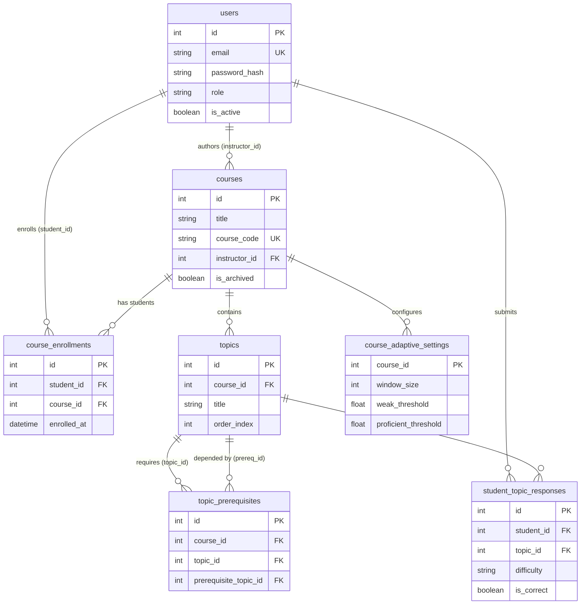

# AdaptLearn — Architecture Design & Cross-Module Integration Proposal
## Modules: M1 (User & Course Management) & M4 (Personalized Learning Paths)

**Document Reference:** `docs/sqa/M1_M4_TEAM_APPROVAL_PROPOSAL.md`  
**Document Type:** Formal Design Proposal for Team Review and Sign-Off  
**Author / Integration Architect:** Hiba Zulfiqar (`2023246`) — Lead for M1 & M4  
**Target Reviewers / Approvers:** Toqeer Ahmed (`2023567`, M3/M5 Lead), Mustajaab Ul Fida Qadri (`2023728`, M2 Lead)  
**Baseline Repository:** `https://github.com/toqeer-ahmed/AdaptLearn` (`commit fb4d3c5`)  
**Status:** **PROPOSED — PENDING FORMAL TEAM APPROVAL**  
**Date:** November 21, 2026  

---

## 1. Executive Summary

This proposal outlines the comprehensive architecture, database models, service interfaces, API contracts, and quality assurance plan for **Module 1 (M1: User & Course Management)** and **Module 4 (M4: Personalized Learning Paths)**.

### Objectives of this Proposal
1. **Fulfill Missing M1 & M4 Capabilities**: Deliver course management, topic hierarchy, prerequisite graph definition with cycle prevention, student enrollment, and full-curriculum personalized learning path evaluation.
2. **Eliminate Temporary Architectural Duplication**: Replace temporary fixture models (`course_owners`, `course_topics`) with authoritative, normalized relational models (`courses`, `topics`, `topic_prerequisites`) without breaking existing M3 or M5 code.
3. **Preserve Verified M2/M3/M5 Baselines**: Ensure all 150 automated tests currently passing on `main` remain completely green by maintaining strict backward compatibility for shared database tables (`course_enrollments`).
4. **Establish Formal Integration Contracts**: Define explicit, versioned internal contracts across M1, M2, M3, M4, and M5 to prevent future integration blockers (DEF-MOD-001).

> [!IMPORTANT]
> **Strict Pre-Implementation Rule**: In accordance with software engineering governance and team collaboration standards (`CONTRIBUTING.md`), this document is a **proposal**. Zero production code will be authored or modified until all affected module owners provide explicit review and approval.

---

## 2. Module 1 Architecture Proposal (User & Course Management)

Module 1 is the structural foundation of AdaptLearn. It provides user authentication (already verified in Milestone 2), course lifecycle management, topic sequencing, prerequisite DAG validation, and student course enrollment.

```
                                M1 Architectural Layering
 ┌─────────────────────────────────────────────────────────────────────────────┐
 │ Presentation / API Layer (backend/app/api/v1/endpoints/courses.py)         │
 │ - Endpoints: GET/POST /courses, PATCH /courses/{id}, POST /courses/{id}/arch│
 │              POST /courses/{id}/enroll, GET/POST /courses/{id}/topics       │
 │              PUT /courses/{id}/topics/order, POST /topics/{id}/prerequisites│
 │ - Guards: Depends(require_role(["instructor", "student"])), owner checks    │
 └──────────────────────────────────────┬──────────────────────────────────────┘
                                        │ Calls DTOs & Service Methods
                                        ▼
 ┌─────────────────────────────────────────────────────────────────────────────┐
 │ Application Service Layer (backend/app/services/course_service.py)          │
 │ - Enforces business rules: course ownership, unique codes, active enrollment│
 │ - Graph Algorithm: Depth-First Search (DFS) Directed Acyclic Graph (DAG)    │
 │   cycle detection (rejects self-prerequisites and circular loops)           │
 └──────────────────────────────────────┬──────────────────────────────────────┘
                                        │ Coordinates Persistence
                                        ▼
 ┌─────────────────────────────────────────────────────────────────────────────┐
 │ Repository Layer (backend/app/repositories/course_repository.py)            │
 │ - Encapsulates SQLAlchemy 2.0 ORM sessions and parameterized queries        │
 │ - Atomic transactions for topic sequential reordering and prerequisite links│
 └──────────────────────────────────────┬──────────────────────────────────────┘
                                        │ Executes DDL / DML
                                        ▼
 ┌─────────────────────────────────────────────────────────────────────────────┐
 │ Domain Persistence Models (backend/app/models/course.py)                    │
 │ - CourseModel ('courses')                - TopicModel ('topics')            │
 │ - TopicPrerequisiteModel ('topic_prereqs')- EnrollmentModel ('course_enroll')│
 └─────────────────────────────────────────────────────────────────────────────┘
```

---

### 2.1 Domain Relational Models (`backend/app/models/course.py`)

All models inherit from `app.db.base.Base` (`DeclarativeBase`), conforming to SQLAlchemy 2.0 and Decision D6.

```python
"""SQLAlchemy ORM models for Module 1: User & Course Management."""

from datetime import datetime, timezone
from sqlalchemy import Boolean, Column, DateTime, ForeignKey, Integer, String, Text, UniqueConstraint, CheckConstraint
from sqlalchemy.orm import relationship

from app.db.base import Base


class CourseModel(Base):
    """Authoritative course entity (FR-04, FR-05)."""
    __tablename__ = "courses"

    id = Column(Integer, primary_key=True, autoincrement=True, index=True)
    title = Column(String(200), nullable=False)
    description = Column(Text, nullable=True)
    course_code = Column(String(50), nullable=False, unique=True, index=True)
    instructor_id = Column(Integer, ForeignKey("users.id"), nullable=False, index=True)
    is_archived = Column(Boolean, nullable=False, default=False, index=True)
    created_at = Column(DateTime, nullable=False, default=lambda: datetime.now(timezone.utc))
    updated_at = Column(DateTime, nullable=True, onupdate=lambda: datetime.now(timezone.utc))

    # Relationships
    instructor = relationship("UserModel", backref="authored_courses")
    topics = relationship("TopicModel", back_populates="course", cascade="all, delete-orphan", order_by="TopicModel.order_index")
    enrollments = relationship("EnrollmentModel", back_populates="course", cascade="all, delete-orphan")


class TopicModel(Base):
    """Course syllabus unit of content (FR-05, FR-06)."""
    __tablename__ = "topics"

    id = Column(Integer, primary_key=True, autoincrement=True, index=True)
    course_id = Column(Integer, ForeignKey("courses.id", ondelete="CASCADE"), nullable=False, index=True)
    title = Column(String(200), nullable=False)
    description = Column(Text, nullable=True)
    order_index = Column(Integer, nullable=False, default=0, index=True)
    created_at = Column(DateTime, nullable=False, default=lambda: datetime.now(timezone.utc))

    course = relationship("CourseModel", back_populates="topics")
    prerequisites = relationship(
        "TopicPrerequisiteModel",
        foreign_keys="TopicPrerequisiteModel.topic_id",
        back_populates="topic",
        cascade="all, delete-orphan",
    )


class TopicPrerequisiteModel(Base):
    """Directed prerequisite relationship between topics of the same course (FR-06)."""
    __tablename__ = "topic_prerequisites"

    id = Column(Integer, primary_key=True, autoincrement=True)
    course_id = Column(Integer, ForeignKey("courses.id", ondelete="CASCADE"), nullable=False, index=True)
    topic_id = Column(Integer, ForeignKey("topics.id", ondelete="CASCADE"), nullable=False, index=True)
    prerequisite_topic_id = Column(Integer, ForeignKey("topics.id", ondelete="CASCADE"), nullable=False, index=True)

    __table_args__ = (
        UniqueConstraint("topic_id", "prerequisite_topic_id", name="uq_topic_prerequisite"),
        CheckConstraint("topic_id != prerequisite_topic_id", name="ck_no_self_prerequisite"),
    )

    topic = relationship("TopicModel", foreign_keys=[topic_id])
    prerequisite_topic = relationship("TopicModel", foreign_keys=[prerequisite_topic_id])


class EnrollmentModel(Base):
    """Student course enrollment record (FR-07 / FR-04)."""
    __tablename__ = "course_enrollments"  # Preserves exact existing table name for M5 backward compatibility

    id = Column(Integer, primary_key=True, autoincrement=True)
    student_id = Column(Integer, ForeignKey("users.id"), nullable=False, index=True)
    course_id = Column(Integer, ForeignKey("courses.id", ondelete="CASCADE"), nullable=False, index=True)
    enrolled_at = Column(DateTime, nullable=False, default=lambda: datetime.now(timezone.utc))

    __table_args__ = (
        UniqueConstraint("student_id", "course_id", name="uq_student_course_enrollment"),
    )

    course = relationship("CourseModel", back_populates="enrollments")
    student = relationship("UserModel")
```

---

### 2.2 Pydantic Validation Schemas (`backend/app/schemas/course.py`)

Conforms strictly to Pydantic v2 and Decision D5 string length bounds.

```python
"""Pydantic validation schemas for Module 1: Course and Topic Management."""

from datetime import datetime
from typing import Optional
from pydantic import BaseModel, ConfigDict, Field, field_validator


class CourseCreateRequest(BaseModel):
    title: str = Field(..., min_length=1, max_length=200, description="Course title")
    description: Optional[str] = Field(None, max_length=2000, description="Course summary")
    course_code: str = Field(..., min_length=3, max_length=50, pattern=r"^[A-Za-z0-9\-_]+$", description="Unique course code")

    @field_validator("title", "course_code")
    @classmethod
    def strip_whitespace(cls, v: str) -> str:
        s = v.strip()
        if not s:
            raise ValueError("Field cannot be empty or whitespace only")
        return s

    model_config = ConfigDict(str_strip_whitespace=True)


class CourseUpdateRequest(BaseModel):
    title: Optional[str] = Field(None, min_length=1, max_length=200)
    description: Optional[str] = Field(None, max_length=2000)

    model_config = ConfigDict(str_strip_whitespace=True)


class CourseEnrollRequest(BaseModel):
    course_code: str = Field(..., min_length=1, max_length=50, description="Instructor enrollment code")


class TopicCreateRequest(BaseModel):
    title: str = Field(..., min_length=1, max_length=200, description="Topic title")
    description: Optional[str] = Field(None, max_length=2000)


class TopicReorderRequest(BaseModel):
    topic_ids: list[int] = Field(..., min_length=1, description="Complete ordered list of topic IDs for the course")


class PrerequisiteCreateRequest(BaseModel):
    prerequisite_topic_id: int = Field(..., gt=0, description="Target prerequisite topic ID")


class CourseResponse(BaseModel):
    id: int
    title: str
    description: Optional[str]
    course_code: str
    instructor_id: int
    is_archived: bool
    created_at: datetime
    is_enrolled: Optional[bool] = False

    model_config = ConfigDict(from_attributes=True)


class TopicResponse(BaseModel):
    id: int
    course_id: int
    title: str
    description: Optional[str]
    order_index: int
    prerequisite_topic_ids: list[int] = []

    model_config = ConfigDict(from_attributes=True)


class EnrollmentResponse(BaseModel):
    id: int
    student_id: int
    course_id: int
    enrolled_at: datetime

    model_config = ConfigDict(from_attributes=True)
```

---

### 2.3 Course Service & Graph Cycle Detection (`backend/app/services/course_service.py`)

The service layer encapsulates business logic and the acyclic prerequisite graph invariant (Assumption A-05).

#### Prerequisite Cycle-Detection Algorithm (Depth-First Search)
Before persisting any prerequisite edge $(T \to P)$, the service executes a cycle check:
1. Validate $T \ne P$ (reject self-prerequisites with HTTP 400).
2. Validate both $T$ and $P$ belong to the same `course_id` (reject cross-course prerequisites with HTTP 400).
3. Load the existing adjacency graph of prerequisites for the course: $G = (V, E)$.
4. Run Depth-First Search starting from the proposed prerequisite $P$:
   * If there is an existing path from $P$ to $T$ ($P \rightsquigarrow T$), adding the edge $(T \to P)$ will form a directed cycle.
   * Reject with `HTTP 409 Conflict`: `"Circular prerequisite dependency detected: adding this prerequisite creates a cycle"`.
5. If no path exists, commit the edge. Time complexity: $\mathcal{O}(V + E)$ where $V \le 50$ topics per course, executing in $< 1\text{ ms}$.

---

### 2.4 API Endpoint Routing (`backend/app/api/v1/endpoints/courses.py`)

```python
# Proposed Endpoint Declarations:
GET    /api/v1/courses                    # List courses (active/enrolled)
POST   /api/v1/courses                    # Create course (Instructor only)
GET    /api/v1/courses/{id}               # View course details
PATCH  /api/v1/courses/{id}               # Edit metadata (Owner only)
POST   /api/v1/courses/{id}/archive       # Archive course (Owner only)
POST   /api/v1/courses/{id}/enroll        # Student enrolls via code
GET    /api/v1/courses/{id}/topics        # View topic DAG (Enrolled or Owner)
POST   /api/v1/courses/{id}/topics        # Add topic (Owner only)
PUT    /api/v1/courses/{id}/topics/order  # Reorder topics atomically (Owner only)
POST   /api/v1/topics/{id}/prerequisites  # Add prerequisite edge (Owner only, DFS check)
DELETE /api/v1/topics/{id}                # Delete topic (Owner only, restricted)
```

---

## 3. Module 4 Architecture Proposal (Personalized Learning Paths)

### 3.1 Verification of Stateless Architecture
* **Authoritative Documentation**: Milestone 1 Report (**Section 4.2, Table 4**) explicitly defines:
  > *"M4 reads topics (M1) and mastery (M3) and delegates the decision to a RecommendationStrategy. **Does not change stored data.**"*
* **Architectural Invariant**: **Module 4 introduces zero database tables.**
  * The personalized learning path is computed dynamically at request time.
  * *Rationale*: If learning paths were stored in a relational table, any quiz submission in M2/M3 would leave stored path rows stale and out-of-sync. Dynamic evaluation guarantees 100% data consistency without caching or invalidation bugs.

---

### 3.2 Two-Phase Hybrid Learning-Path Generation Algorithm

To fulfill both the sequenced curriculum contract (`docs/api.md` §5) and the pedagogical recommendation rules (FR-17, FR-18, FR-19):

```
                        Two-Phase Learning-Path Synthesis
 ┌─────────────────────────────────────────────────────────────────────────────┐
 │ Phase 1: Syllabus Traversal & Prerequisite Unlocking                        │
 │ 1. Load all course topics sorted by order_index ascending.                  │
 │ 2. Retrieve student mastery level for each topic (from M3).                 │
 │ 3. For each topic T:                                                        │
 │    - If T has zero prerequisites -> is_unlocked = True, locked_reason = None│
 │    - If every prerequisite P of T has mastery(P) == 'Proficient' ->         │
 │      is_unlocked = True, locked_reason = None                               │
 │    - If any prerequisite P is not 'Proficient' ->                           │
 │      is_unlocked = False, locked_reason = "Prerequisite 'P' not yet Prof."  │
 └──────────────────────────────────────┬──────────────────────────────────────┘
                                        │ Unlocked, Non-Proficient Candidates
                                        ▼
 ┌─────────────────────────────────────────────────────────────────────────────┐
 │ Phase 2: Pedagogical Recommendation Tagging (M3 Engine Delegation)          │
 │ 1. Collect all candidate topics where is_unlocked == True and               │
 │    status != 'Proficient'.                                                  │
 │ 2. Invoke GoF Factory: get_strategy_creator("rule_based").recommend(...)    │
 │ 3. For topics in recommendation output:                                     │
 │    - Set is_recommended = True                                              │
 │    - Attach rationale (e.g. "Topic is Weak...", "Suggested starting point")│
 │ 4. For all other topics in curriculum:                                      │
 │    - Set is_recommended = False, rationale = None                           │
 └─────────────────────────────────────────────────────────────────────────────┘
```

---

### 3.3 Learning-Path Pydantic Schemas (`backend/app/schemas/learning_path.py`)

```python
"""Pydantic schemas for Module 4: Personalized Learning Paths."""

from typing import Optional
from pydantic import BaseModel, ConfigDict, Field


class TopicPathItem(BaseModel):
    topic_id: int
    title: str
    description: Optional[str]
    order_index: int
    status: str = Field(..., description="'Proficient', 'Developing', 'Weak', or 'Not Assessed'")
    score: float = Field(..., ge=0.0, le=1.0)
    is_unlocked: bool
    is_recommended: bool
    locked_reason: Optional[str] = None
    prerequisite_topic_ids: list[int] = []

    model_config = ConfigDict(from_attributes=True)


class LearningPathResponse(BaseModel):
    course_id: int
    student_id: int
    total_topics: int
    unlocked_count: int
    completed_count: int
    completion_percentage: float = Field(..., ge=0.0, le=100.0)
    path: list[TopicPathItem]

    model_config = ConfigDict(from_attributes=True)
```

---

### 3.4 Learning Path Router (`backend/app/api/v1/endpoints/learning_paths.py`)

```python
# Proposed Endpoint Declaration:
GET /api/v1/courses/{id}/learning-path
```
* **Authorization**: Authenticated. Role `'student'` (must be enrolled in `course_id`) OR Role `'instructor'` (must own `course_id`).
* **Query Parameters**: `student_id: Optional[int] = None` (allowed only for course instructors to view a student's diagnostic path).

---

## 4. Cross-Module Integration Contracts

This section defines the 5 inter-module contracts. All are marked as **PROPOSED**.

```
                              Integration Contract Graph
   ┌───────────────────────┐                    ┌───────────────────────┐
   │ M2: Quiz & Assessment │                    │ M3: Adaptive Engine   │
   │ (Mustajaab)           │                    │ (Toqeer)              │
   └───────────┬───────────┘                    └───────────┬───────────┘
               │ Contract 5: Check Enrollment               │ Contract 1: Topic DAG
               │ & Topic Existence                          │ Contract 3: Student Mastery
               ▼                                            ▼
   ┌────────────────────────────────────────────────────────────────────┐
   │               M1: User & Course Management (Hiba)                  │
   └───────────────────┬────────────────────────────┬───────────────────┘
                       │ Contract 2: DAG & Enroll   │ Contract 4: Ownership
                       ▼                            ▼ & Enrollment Check
   ┌───────────────────────────────────┐        ┌───────────────────────┐
   │ M4: Personalized Learning Paths   │        │ M5: Progress/Dashboard│
   │ (Hiba)                            │        │ (Toqeer)              │
   └───────────────────────────────────┘        └───────────────────────┘
```

---

### Contract 1: M1 $\to$ M3 (Course Topics & Prerequisite DAG)
* **Provider**: M1 (`CourseRepository`)
* **Consumer**: M3 (`AdaptiveService`, `AdaptiveRepository`)
* **Purpose**: Provide the real course topic structure and prerequisite mapping to replace M3's temporary `course_topics` table.
* **Proposed Interface**: `CourseRepository.get_course_topics_with_prerequisites(course_id: int) -> list[TopicStructureDTO]`
* **Data Format**:
  ```python
  @dataclass(frozen=True)
  class TopicStructureDTO:
      topic_id: int
      title: str
      order_index: int
      prerequisite_topic_ids: tuple[int, ...]
  ```
* **Error Handling**: Non-existent `course_id` returns empty list `[]`.
* **Compatibility Risk**: M3 currently queries `AdaptiveRepository.get_course_topics()`. M3 will be updated to call M1's repository provider without altering M3 calculation logic.

---

### Contract 2: M1 $\to$ M4 (Curriculum Topology & Enrollment)
* **Provider**: M1 (`CourseRepository`, `CourseService`)
* **Consumer**: M4 (`LearningPathService`)
* **Purpose**: Verify student enrollment and load full course topic DAG for learning path construction.
* **Proposed Interface**:
  1. `CourseRepository.is_student_enrolled(student_id: int, course_id: int) -> bool`
  2. `CourseRepository.get_course_topics_with_prerequisites(course_id: int) -> list[TopicStructureDTO]`
* **Error Handling**:
  * If student not enrolled: raises `HTTPException(403, "Student is not enrolled in this course")`.
  * If course not found: raises `HTTPException(404, "Course not found")`.
* **Authorization**: Gated by `app.core.auth.get_current_user`.

---

### Contract 3: M3 $\to$ M4 (Student Topic Mastery Retrieval)
* **Provider**: M3 (`AdaptiveService`, `MasteryCalculator`)
* **Consumer**: M4 (`LearningPathService`)
* **Purpose**: Supply student's current mastery scores and bands across all course topics to evaluate prerequisite satisfaction.
* **Proposed Interface**: `AdaptiveService.get_student_course_mastery(student_id: int, course_id: int) -> dict[int, TopicMasteryDTO]`
* **Data Format**:
  ```python
  @dataclass(frozen=True)
  class TopicMasteryDTO:
      topic_id: int
      score: float       # In range [0.0, 1.0]
      level: str         # 'Proficient', 'Developing', 'Weak', 'Not Assessed'
      response_count: int
  ```
* **Error Handling**: Student with zero attempts returns score `0.0` and level `'Not Assessed'`.

---

### Contract 4: M1 $\to$ M5 (Ownership & Enrolled Roster)
* **Provider**: M1 (`CourseRepository`)
* **Consumer**: M5 (`ProgressService`, `AnalyticsService`)
* **Purpose**: Provide course ownership verification and enrolled student rosters for instructor analytics dashboards.
* **Proposed Interface**:
  1. `CourseRepository.is_course_owner(course_id: int, instructor_id: int) -> bool`
  2. `CourseRepository.get_enrolled_student_ids(course_id: int) -> list[int]`
* **Compatibility Risk**: Currently, M5 queries `ProgressRepository.is_course_owner()` backed by table `course_owners`.
* **Migration Strategy**: Update `ProgressRepository.is_course_owner` to query `courses.instructor_id`. Table `course_enrollments` remains identical, ensuring zero test breakage.

---

### Contract 5: M2 $\to$ M1 (Assessment Verification)
* **Provider**: M1 (`CourseRepository`)
* **Consumer**: M2 (`QuizService`)
* **Purpose**: Verify student enrollment before starting a quiz attempt, and ensure created questions attach to valid course topics.
* **Proposed Interface**:
  1. `CourseRepository.is_student_enrolled(student_id: int, course_id: int) -> bool`
  2. `CourseRepository.topic_exists_in_course(topic_id: int, course_id: int) -> bool`
* **Error Handling**: Unauthorized attempt returns HTTP 403; non-existent topic returns HTTP 400.

---

## 5. Database Ownership & Relational Migration Matrix



### Relational Ownership & Consumer Table

| Table Name | Entity Class | Module Owner | Consumers (Read Only) | Migration & Backward Compatibility Strategy |
| :--- | :--- | :---: | :--- | :--- |
| `users` | `UserModel` | **Auth / Core** | All Modules (`M1..M5`) | Retain exact schema in `backend/app/models/user.py`. |
| `courses` | `CourseModel` | **M1 (Hiba)** | `M2`, `M3`, `M4`, `M5` | **New Table**. Supersedes `course_owners`. Column `instructor_id` becomes authoritative. |
| `topics` | `TopicModel` | **M1 (Hiba)** | `M2`, `M3`, `M4`, `M5` | **New Table**. Supersedes M3 fixture `course_topics`. |
| `topic_prerequisites` | `TopicPrerequisiteModel` | **M1 (Hiba)** | `M3`, `M4` | **New Table**. Replaces M3's JSON string `prerequisites_json`. |
| `course_enrollments` | `EnrollmentModel` | **M1 (Hiba)** | `M2`, `M4`, `M5` | **Retain Exact Name & Columns**. Currently in `models/progress.py`. Preserving table name guarantees M5 tests pass. |
| `course_adaptive_settings`| `CourseSettingsModel` | **M3 (Toqeer)** | `M3`, `M5` | Retain exact schema in `backend/app/models/adaptive.py`. |
| `student_topic_responses` | `StudentTopicResponseModel`| **M3 (Toqeer)** | `M3`, `M4`, `M5` | Retain exact schema in `backend/app/models/adaptive.py`. |

---

## 6. Team Approval Decision Table

The 10 architectural decisions below require formal consensus before implementation commences.

| # | Architectural Decision Area | Available Options | Recommended Option | Technical & Pedagogical Rationale | Affected Modules | Required Approvers |
| :-: | :--- | :--- | :--- | :--- | :---: | :---: |
| **1** | **Course Code Generation** | A. Instructor-chosen string (e.g. `SE423-2026`)<br>B. System random token (e.g. `C-8F3B9A`) | **Option A** | Aligns with natural academic course codes; validated with unique index. | M1 | Hiba, Toqeer |
| **2** | **Topic Deletion Policy** | A. Restricted (`400` error if questions/attempts exist)<br>B. Soft-deletion (`is_active = false`)<br>C. Hard cascade delete | **Option A** | Prevents dangling foreign keys and historical quiz record corruption. | M1, M2 | Hiba, Mustajaab |
| **3** | **Archived Course Visibility** | A. Read-only historical access for enrolled students<br>B. Completely hidden from all students | **Option A** | Satisfies FR-04 (no new attempts/enrollments) while preserving student review (NFR-06). | M1, M4, M5 | Hiba, Toqeer |
| **4** | **Prerequisite Mastery Threshold** | A. `Proficient` ($\ge 0.80$)<br>B. `Developing` ($\ge 0.50$) | **Option A** | Satisfies mastery learning pedagogy and aligns with `docs/api.md` §5 contract. | M4, M3 | Hiba, Toqeer |
| **5** | **Instructor Learning-Path View** | A. Allow instructor query param `?student_id={id}`<br>B. Student-only access | **Option A** | Enables diagnostic advising and cohort monitoring (FR-22). | M4, M5 | Hiba, Toqeer |
| **6** | **Course Enrollment Table Ownership** | A. M1 adopts `course_enrollments` unchanged<br>B. Create new table `enrollments` | **Option A** | Zero regression risk for M5's 150 existing passing tests. | M1, M5 | Hiba, Toqeer |
| **7** | **Course Owner Representation** | A. `CourseModel.instructor_id` replacing `course_owners`<br>B. Keep duplicate `course_owners` table | **Option A** | Eliminates redundant table; update `ProgressRepository` to query `courses`. | M1, M5 | Hiba, Toqeer |
| **8** | **M3 Mastery Interface for M4** | A. Service method `get_student_course_mastery()`<br>B. M4 queries raw response tables | **Option A** | Maintains strict service encapsulation and NFR-05 engine isolation. | M3, M4 | Toqeer, Hiba |
| **9** | **M4 Learning Path Algorithm** | A. Two-phase hybrid synthesis (DAG + Strategy)<br>B. Flat recommendations only | **Option A** | Satisfies both the full curriculum view (`api.md` §5) and FR-17/18 rules. | M4, M3 | Hiba, Toqeer |
| **10**| **Implementation Sequence** | A. M1 Relational Core first $\to$ then M4 Service<br>B. Concurrent development with mock models | **Option A** | Eliminates mock rework; true models available for M4 testing immediately. | M1, M4 | Hiba |

---

## 7. Software Quality Assurance Plan (SQA)

### Test Scenarios Mapped to Original Requirements

```
                                 SQA Verification Matrix
 ┌─────────────────────────────────────────────────────────────────────────────┐
 │ Category 1: M1 Unit & Boundary Tests                                        │
 │ - TC-M1-01: Valid CourseModel persistence with unique course_code.          │
 │ - TC-M1-02: Duplicate course_code raises IntegrityError / 409 Conflict.     │
 │ - TC-M1-03: Self-prerequisite (topic_id == prereq_id) raises CheckConstraint│
 │ - TC-M1-04: DFS Cycle Detection: Direct cycle (A -> B, B -> A) rejected.   │
 │ - TC-M1-05: DFS Cycle Detection: Multi-node cycle (A -> B -> C -> A) rejected│
 │ - TC-M1-06: Atomic sequential topic reordering updates order_index cleanly. │
 ├─────────────────────────────────────────────────────────────────────────────┤
 │ Category 2: M1 API Integration Tests                                        │
 │ - TC-M1-07: POST /courses created by Instructor returns 201 Created.        │
 │ - TC-M1-08: POST /courses attempted by Student returns 403 Forbidden.       │
 │ - TC-M1-09: PATCH /courses/{id} by non-owner returns 403 Forbidden.         │
 │ - TC-M1-10: POST /courses/{id}/archive marks is_archived = true.            │
 │ - TC-M1-11: POST /courses/{id}/enroll with valid code returns 200/201.      │
 │ - TC-M1-12: POST /courses/{id}/enroll on archived course returns 400.       │
 │ - TC-M1-13: Duplicate enrollment returns 409 Conflict.                      │
 │ - TC-M1-14: GET /courses/{id}/topics by unenrolled student returns 403.     │
 ├─────────────────────────────────────────────────────────────────────────────┤
 │ Category 3: M4 Unit & Engine Integration Tests                              │
 │ - TC-M4-01: Cold-start student (zero attempts): prerequisite-free topics    │
 │             are unlocked and recommended with starting-point rationale.     │
 │ - TC-M4-02: Prerequisite satisfaction: Topic unlocks when prerequisite     │
 │             achieves Proficient (score >= 0.80).                            │
 │ - TC-M4-03: Prerequisite unmet: Topic locked when prerequisite is Developing │
 │             (score 0.65); locked_reason cites prerequisite title.           │
 │ - TC-M4-04: All topics Proficient: all unlocked, 0 recommended, 100% comp. │
 │ - TC-M4-05: Determinism (NFR-10): Identical inputs produce identical order. │
 ├─────────────────────────────────────────────────────────────────────────────┤
 │ Category 4: M4 API Integration Tests                                        │
 │ - TC-M4-06: GET /courses/{id}/learning-path returns complete curriculum.   │
 │ - TC-M4-07: Unauthenticated request returns 401 Unauthorized.               │
 │ - TC-M4-08: Unenrolled student returns 403 Forbidden.                       │
 ├─────────────────────────────────────────────────────────────────────────────┤
 │ Category 5: Regression & Layer Isolation Tests                              │
 │ - TC-REG-01: All 150 existing baseline tests remain 100% passing.           │
 │ - TC-REG-02: AST layer scanner (test_layers.py) verifies zero engine leaks. │
 └─────────────────────────────────────────────────────────────────────────────┘
```

---

## 8. Integration Risks & Failure Handling

| Failure Condition | Expected System Behavior & Resilience Strategy |
| :--- | :--- |
| **Student not enrolled in course** | Endpoints return `HTTP 403 Forbidden` (`"Student is not enrolled in this course"`). Zero topic content or mastery metrics leaked (NFR-06). |
| **Student has zero quiz attempts** | Graceful cold-start handling (FR-19): Topics with 0 prerequisites evaluate as `is_unlocked: true` and `is_recommended: true` with starting-point rationale. |
| **Prerequisite cycle injection attempt** | DFS traversal catches cycle before commit; returns `HTTP 409 Conflict`. Database transaction rolls back; graph integrity preserved. |
| **Instructor deletes topic with questions** | Foreign key restriction catches dependency; returns `HTTP 400 Bad Request` (`"Cannot delete topic referenced by existing questions"`). |
| **M3 Calculation Service error** | If M3 fails to evaluate responses, M4 defaults topic to `'Not Assessed'` (score: 0.0), preserving learning-path availability. |

---

## 9. Team Questions for Review Meeting

1. **To Toqeer Ahmed (M3/M5 Lead)**:
   * Do you agree with redirecting `ProgressRepository.is_course_owner()` to query `courses.instructor_id` so we can deprecate `course_owners` without breaking analytics?
   * Can `AdaptiveService` expose `get_student_course_mastery(student_id, course_id)` as specified in Contract 3?
2. **To Mustajaab Ul Fida Qadri (M2 Lead)**:
   * Does M2 agree with restricting topic deletions (`HTTP 400`) if questions are linked to the topic?
   * Are you prepared to integrate Contract 5 (verifying student enrollment via M1 before starting a quiz attempt)?

---

## 10. Recommended Implementation Roadmap

```
Sprint 1: Environment & Virtualenv Gating (Day 1)
 ├── 1. Initialize backend/venv and install requirements.txt.
 └── 2. Verify all 150 baseline tests pass locally.

Sprint 2: M1 Relational Core & Service (Branch: feature/m1-course-management, Days 2–3)
 ├── 3. Create app/models/course.py (Course, Topic, Prerequisite, Enrollment).
 ├── 4. Create app/schemas/course.py.
 ├── 5. Implement CourseRepository & DFS cycle detection in CourseService.
 └── 6. Write model and cycle unit tests (TC-M1-01..06).

Sprint 3: M1 API Endpoints & Access Control (Days 4–5)
 ├── 7. Implement app/api/v1/endpoints/courses.py.
 ├── 8. Mount /courses in app/api/v1/api.py with require_role guards.
 └── 9. Author API integration tests (TC-M1-07..14).

Sprint 4: M4 Learning Path Integration (Branch: feature/m4-learning-paths, Days 6–7)
 ├── 10. Create app/schemas/learning_path.py.
 ├── 11. Implement LearningPathService (Two-Phase DAG Traversal + Strategy).
 ├── 12. Implement app/api/v1/endpoints/learning_paths.py (GET /courses/{id}/learning-path).
 └── 13. Write M4 unit and API integration tests (TC-M4-01..08).

Sprint 5: Regression Gate & Pull Request (Day 8)
 ├── 14. Run full test suite ($env:PYTHONPATH='backend'; pytest backend/tests) -> 180+ tests pass.
 ├── 15. Verify AST layer isolation via tests/architecture/test_layers.py.
 └── 16. Submit Pull Request for team review following CONTRIBUTING.md.
```
