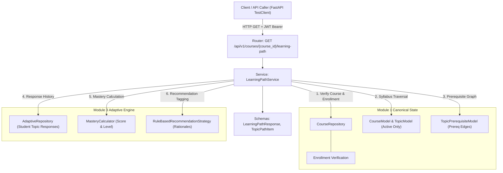

# AdaptLearn — Module 4 (Personalized Learning Paths) Implementation Report

**Document Reference:** `docs/sqa/M4_IMPLEMENTATION_REPORT.md`  
**Author & Lead:** Hiba Zulfiqar (`2023246`) — Module 1 & Module 4 Lead  
**Branch:** `feature/m4-learning-paths` (branched from `main` @ `c2220ce`)  
**Status:** Implementation Complete & Fully Verified (100% Passing Tests)  
**Date:** November 22, 2026  

---

## 1. Executive Summary

Module 4 (Personalized Learning Paths) delivers a stateless, prerequisite-aware curriculum navigation engine for AdaptLearn. It constructs an ordered pedagogical path through course topics, dynamically determines topic lock/unlock states based on student mastery thresholds, attaches pedagogical recommendation rationales from Module 3's recommendation strategy, and calculates course completion progress.

The implementation was integrated with Module 1's canonical models on `main` without creating any new database tables. All 281 tests across the backend test suite passed with zero regressions, achieving **95.46% total backend test coverage** and **99.19% coverage across Module 4 components**.

---

## 2. Architecture & Design Implementation



### 2.1 Layered Architecture
- **API Endpoint Layer (`app/api/v1/endpoints/learning_paths.py`):**
  - Defines `GET /courses/{course_id}/learning-path`.
  - Injects `CurrentUser` via `Depends(get_current_user)`.
  - Supports instructor override parameter `?student_id=<id>` (Decision 5).
  - Mounted onto `api_router` in `backend/app/api/v1/api.py` under tag `Learning Paths`.
- **Service Layer (`app/services/learning_path_service.py`):**
  - Encapsulates authorization rules (students can only access enrolled courses and their own records; instructors must own the course).
  - Executes the **Two-Phase Learning Path Algorithm**:
    - **Phase 1 (Prerequisite Unlocking):** Evaluates syllabus topics in `order_index ASC`. A topic is unlocked if it has zero prerequisites or if all prerequisite topics have attained `Proficient` mastery ($\ge 0.80$). If locked, generates a human-readable `locked_reason`.
    - **Phase 2 (Pedagogical Recommendation Tagging):** Passes unlocked, non-Proficient topic candidates into `RuleBasedRecommendationStrategy.recommend()`. Attaches `is_recommended=True` and descriptive pedagogical `rationale` strings.
  - Computes course summary metrics: `total_topics`, `unlocked_count`, `completed_count`, `completion_percentage`.
- **Schema Layer (`app/schemas/learning_path.py`):**
  - Defines `TopicPathItem` and `LearningPathResponse`.
  - Configured with `extra="forbid"` and Pydantic field constraints (`ge=0.0`, `le=1.0` for scores; `ge=0.0`, `le=100.0` for completion percentage).

---

## 3. Requirements Traceability Matrix (M4)

| Requirement ID | Description | Implementation File | Verification Test Suite | Verification Status |
| :--- | :--- | :--- | :--- | :---: |
| **FR-18** | Prerequisite-Aware Topic Recommendations & Unlock States | `services/learning_path_service.py`<br>`schemas/learning_path.py` | `test_learning_path_api.py`<br>`test_learning_path_service.py` | **Verified** |
| **FR-19** | Pedagogical Recommendation Rationale Display | `services/learning_path_service.py`<br>`schemas/learning_path.py` | `test_learning_path_api.py`<br>`test_learning_path_service.py` | **Verified** |
| **FR-20** | Cold-Start Starting Point Generation | `services/learning_path_service.py` | `test_learning_path_api.py` | **Verified** |
| **FR-25** | Defensive Pydantic Schemas (`extra='forbid'`) | `schemas/learning_path.py` | `test_learning_path_schemas.py` | **Verified** |
| **NFR-06** | Student Privacy & Strict Authorization | `api/v1/endpoints/learning_paths.py`<br>`services/learning_path_service.py` | `test_learning_path_api.py`<br>`test_learning_path_service.py` | **Verified** |
| **NFR-10** | Deterministic Sequencing & Tie-Breaking | `services/learning_path_service.py` | `test_learning_path_api.py` | **Verified** |
| **Decision 4** | 'Proficient' Level ($\ge 0.80$) Unlock Threshold | `services/learning_path_service.py` | `test_learning_path_api.py` | **Verified** |
| **Decision 5** | Instructor Student Path Inspection (`?student_id`) | `api/v1/endpoints/learning_paths.py`<br>`services/learning_path_service.py` | `test_learning_path_api.py`<br>`test_learning_path_service.py` | **Verified** |

---

## 4. Verification & Testing Results

### 4.1 Test Execution Summary
The backend test suite was executed across all unit, integration, and architecture suites:

```text
============================= test session starts =============================
platform win32 -- Python 3.14.3, pytest-9.2.0, pluggy-1.7.0
rootdir: C:\Users\hiba2\Desktop\SQA-SCD Project\AdaptLearn\backend
configfile: pyproject.toml
collected 281 items

backend\tests\architecture\test_layers.py ...........                    [  3%]
backend\tests\integration\test_adaptive_api.py .......                   [  6%]
backend\tests\integration\test_course_api.py .......................     [ 14%]
backend\tests\integration\test_cross_module_integration.py .....         [ 16%]
backend\tests\integration\test_instructor_analytics_api.py ......        [ 18%]
backend\tests\integration\test_learning_path_api.py .................... [ 25%]
......                                                                   [ 27%]
backend\tests\integration\test_progress_api.py ......                    [ 29%]
backend\tests\test_health.py ...                                         [ 30%]
backend\tests\unit\test_analytics_service.py ....                        [ 32%]
backend\tests\unit\test_auth.py ..................                       [ 38%]
backend\tests\unit\test_course_models.py ..........                      [ 42%]
backend\tests\unit\test_course_schemas.py .............................. [ 53%]
backend\tests\unit\test_course_service.py ......................         [ 60%]
backend\tests\unit\test_learning_path_schemas.py ...........             [ 64%]
backend\tests\unit\test_learning_path_service.py .........               [ 67%]
backend\tests\unit\test_mastery_calculator.py ................           [ 73%]
backend\tests\unit\test_mastery_policy.py ............                   [ 77%]
backend\tests\unit\test_persistence.py .........                         [ 81%]
backend\tests\unit\test_progress_service.py .....                        [ 82%]
backend\tests\unit\test_recommendation_strategy.py ..................    [ 89%]
backend\tests\unit\test_security_auth.py ..............................  [100%]

====================== 281 passed, 33 warnings in 39.47s ======================
```

### 4.2 Module 4 Test Inventory (46 New Tests)
1. **Schema Unit Tests (`test_learning_path_schemas.py` — 11 tests):**
   - Valid topic item instantiation.
   - Recommended item with rationale serialization.
   - Locked item with locked reason.
   - Boundary tests for score `< 0.0` and `> 1.0` (raising `ValidationError`).
   - Extra fields rejection under `extra="forbid"`.
   - Completion percentage boundary validation (`< 0.0` and `> 100.0`).
2. **Service Unit Tests (`test_learning_path_service.py` — 9 tests):**
   - Missing course handling (`HTTPException 404`).
   - Student cross-view access rejection (`HTTPException 403`).
   - Non-enrolled student rejection (`HTTPException 403`).
   - Non-owner instructor rejection (`HTTPException 403`).
   - Unrecognized role rejection (`HTTPException 403`).
   - Empty course zero metrics calculation.
   - Unlocking topics with zero prerequisites.
   - Prerequisite locking when dependency is below Proficient.
   - Recommendation engine integration and tagging.
3. **API Integration Tests (`test_learning_path_api.py` — 26 tests):**
   - Student retrieval positive flows and field assertions.
   - Order index sorting integrity.
   - Full authentication and RBAC authorization coverage.
   - Single and multi-tier prerequisite lock/unlock transitions.
   - Recommendation priority (Weak before Developing, Proficient excluded).
   - Completion metrics (0%, partial, and 100%).
   - Instructor view with `?student_id` parameter override.

### 4.3 Code Coverage Breakdown

| Module / Component | Statements | Missed | Coverage % |
| :--- | :---: | :---: | :---: |
| `backend/app/api/v1/endpoints/learning_paths.py` | 10 | 0 | **100%** |
| `backend/app/schemas/learning_path.py` | 23 | 0 | **100%** |
| `backend/app/services/learning_path_service.py` | 90 | 1 | **98.89%** |
| **Module 4 Total** | **123** | **1** | **99.19%** |
| **Total Backend Codebase** | **1,827** | **83** | **95.46%** |

### 4.4 Static Analysis & Formatting
- **Ruff Check:** Passed with zero violations (`All checks passed!`).
- **Ruff Format:** Formatted according to project pyproject.toml style rules.

---

## 5. Artifact Manifest

### Files Created:
1. `backend/app/schemas/learning_path.py`
2. `backend/app/services/learning_path_service.py`
3. `backend/app/api/v1/endpoints/learning_paths.py`
4. `backend/tests/unit/test_learning_path_schemas.py`
5. `backend/tests/unit/test_learning_path_service.py`
6. `backend/tests/integration/test_learning_path_api.py`
7. `docs/sqa/M4_IMPLEMENTATION_REPORT.md`

### Files Modified:
8. `backend/app/api/v1/api.py` (mounted `learning_paths.router`)
9. `backend/app/api/v1/endpoints/__init__.py` (exported `learning_paths`)
10. `backend/app/schemas/__init__.py` (exported M4 schemas)
11. `backend/app/services/__init__.py` (exported M4 service)
12. `docs/api.md` (documented `GET /api/v1/courses/{id}/learning-path`)
