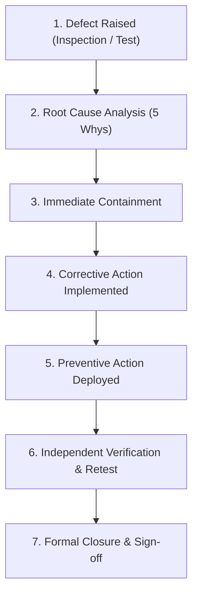

# Corrective and Preventive Action (CAPA) Log

> **Document Status**: Active Quality Document (Framework Established / Awaiting Inspection Input)<br>
> **Project**: AdaptLearn<br>
> **Course**: Software Quality Assurance (SE431)<br>
> **Standard Reference**: IEEE Std 1012 / ISO 9001 Clause 10.2 (Nonconformity and Corrective Action)<br>
> **Current Status**: **0 Active CAPAs** *(Formal Fagan inspection pending external evaluator; no synthetic findings)*

---

## 1. CAPA Quality Framework

The Corrective and Preventive Action (CAPA) process ensures that software defects, non-conformances, and architectural deviations discovered during formal technical inspections or automated testing are systematically analyzed, remediated, and prevented from recurring.

### Definitions
- **Correction / Containment**: Immediate action taken to address an active defect (e.g., bug fix, hotfix).
- **Corrective Action (CA)**: Action taken to eliminate the identified root cause of a detected non-conformity to prevent its recurrence.
- **Preventive Action (PA)**: Systemic, proactive action taken to eliminate the cause of a potential non-conformity in similar modules or future sprints (e.g., new automated architecture test, CI linter rule, process check).

---

## 2. CAPA Workflow Lifecycle



1. **Identification**: Non-conformance logged from Fagan inspection, static analysis, or automated test failure.
2. **Investigation & RCA**: Author and QA Lead perform Root Cause Analysis (5 Whys technique) to determine underlying cause (e.g., requirement ambiguity, missing boundary check, training gap).
3. **Action Planning**: Specific corrective and preventive steps agreed with designated owners.
4. **Implementation**: Code or configuration changes committed with traceability back to the CAPA ID.
5. **Verification**: Moderator or QA Lead independently verifies fix against regression suite and static checks.
6. **Closure**: Signed off only with tangible automated test evidence; unresolved items remain Open.

---

## 3. CAPA Log Table

> **Traceability Policy**: In strict adherence to `AGENTS.md` (Zero Fabrication Policy), no fabricated CAPAs or simulated closures are recorded. Real CAPAs will be registered immediately upon conclusion of the live Fagan inspection meeting.

| CAPA ID | Source Finding ID | Problem Description | Root Cause Category | Immediate Containment | Corrective Action | Preventive Action | Assigned Owner | Target Date | Verification Evidence | Status |
| :---: | :---: | :--- | :---: | :--- | :--- | :--- | :---: | :---: | :--- | :---: |
| *[CAPA-001]* | *[DEF-FND-001]* | *[Pending inspection execution]* | *[Logic / Math / Boundary / Arch]* | *[Containment step]* | *[Root cause fix]* | *[Systemic check / CI rule]* | *[Assignee]* | *[Date]* | *[Test case / Run log]* | *Pending* |
| *[CAPA-002]* | *[DEF-FND-002]* | *[Pending inspection execution]* | *[Logic / Math / Boundary / Arch]* | *[Containment step]* | *[Root cause fix]* | *[Systemic check / CI rule]* | *[Assignee]* | *[Date]* | *[Test case / Run log]* | *Pending* |

---

## 4. Root Cause Analysis (RCA) Guidelines

When completing the investigation for a formal finding, the author must document:

```markdown
### [CAPA-XXX]: Detailed Investigation Record
- **Source Finding**: [e.g., DEF-FND-001 / FND-001]
- **Date Initiated**: YYYY-MM-DD
- **Investigator**: [Author / QA Lead]
- **Severity**: Major (S1) / Minor (S2)

#### 1. Problem Statement
Precise, factual description of what failed, under what input conditions, and what requirements were violated.

#### 2. Root Cause Analysis (5 Whys)
- *Why 1*: Why did the calculation/behavior fail?
- *Why 2*: Why was that condition unhandled?
- *Why 3*: Why did the unit tests not anticipate it?
- *Why 4*: Why was the boundary missing in the design?
- *Why 5*: Core root cause (systemic / cognitive / tooling gap).

#### 3. Corrective Action Plan
- Code/file changes required:
- Associated test cases added:

#### 4. Preventive Action Plan
- Static analysis rule, architecture scanner update, or CI gate added to prevent recurrence across other modules:

#### 5. Verification & Closure
- **Verified By**: [Moderator / External Inspector]
- **Verification Date**: YYYY-MM-DD
- **Test Evidence**: [Link to test execution output or commit]
- **Final Disposition**: Closed / Re-opened / Ineffective
```

---

## 5. CAPA Metrics & Status Summary

- **Total CAPAs Registered**: 0
- **Open CAPAs**: 0
- **Verified Closed CAPAs**: 0
- **Unresolved / In-Progress Items**: 0
- **External Inspection Gate**: **BLOCKED ON LIVE INSPECTION EXECUTION** *(Awaiting external evaluator assignment by course faculty)*.

