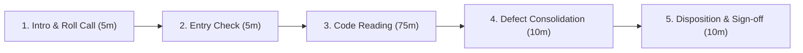

# Formal Technical Inspection Package & Report

> **Document Status**: Active Inspection Package (Preparation Complete / Inspection Scheduled) 
> **Project**: AdaptLearn 
> **Course**: Software Quality Assurance (SE431) 
> **Methodology**: Fagan Formal Inspection Process (IEEE Std 1028) 
> **Execution Status**: **PLANNED / PREPARED** *(Inspection has not yet occurred; no fabricated findings)*

---

## 1. Inspection Overview & Objectives

In accordance with IEEE Std 1028 and the SE431 Software Quality Assurance curriculum, a formal Fagan inspection is organized to detect defects, verify architectural isolation, and validate algorithmic correctness in the core computational engine of AdaptLearn.

### Core Objectives
1. **Algorithmic Correctness**: Verify the mathematical accuracy of the difficulty-weighted mastery score calculation against Milestone 1 Section 9.2 (FR-16).
2. **Boundary & Threshold Integrity**: Ensure mastery level classifications (`Weak`, `Developing`, `Proficient`, `Not Assessed`) handle boundary conditions, zero values, and out-of-range thresholds safely (FR-17, TC-17-1..4).
3. **Pedagogical Ordering Logic**: Validate that the recommendation strategy enforces priority ordering (Weak before Developing, Proficient excluded), circular-safe prerequisite constraints, and deterministic tie-breaking (FR-18, FR-19, NFR-10).
4. **Strict Engine Isolation (NFR-05)**: Verify that `app/engine/` contains zero web framework (`FastAPI`), ORM (`SQLAlchemy`), or data-validation (`Pydantic`) dependencies, maintaining pure Python isolation.

---

## 2. Selected Inspection Artifacts

The inspection scope is focused on the pure computational core located in `backend/app/engine/`. This selection ensures deep, comprehensive coverage within standard Fagan inspection pacing (150–250 lines per hour for a 2-hour session).

| Artifact ID | File Path | Version / Commit | Line Count | Primary Requirements Covered |
| :---: | :--- | :---: | :---: | :--- |
| **ART-01** | `backend/app/engine/mastery_policy.py` | Commit `5e56bf5` | 97 LOC | FR-17 (Classification), FR-20 (Configurability), NFR-10 (Determinism) |
| **ART-02** | `backend/app/engine/mastery_calculator.py` | Commit `5e56bf5` | 163 LOC | FR-16 (Mastery formula), FR-20 (Parameters), NFR-10 (Determinism) |
| **ART-03** | `backend/app/engine/recommendation_strategy.py` | Commit `5e56bf5` | 253 LOC | FR-18 (Ordering & Prerequisites), FR-19 (Rationales), NFR-10 |
| **Total** | **Adaptive Engine Core** | **Baseline 1.0.0** | **513 LOC** | **M3 / M4 Computational Baseline** |

### Supporting Reference Materials (Read-Only Context)
- `docs/requirements.md` (FR-16, FR-17, FR-18, FR-19, FR-20, NFR-05, NFR-10, NFR-11)
- `docs/decisions.md` (Decision D1: Engine Isolation; Decision D4: Recommendation Rules)
- `backend/tests/architecture/test_layers.py` (Automated AST layer boundary verification)
- `backend/tests/unit/` (Unit test suites covering TC-16, TC-17, TC-18 scenarios)

---

## 3. Inspection Roles & Participants

The Fagan inspection process enforces strict role segregation. The author does not lead or moderate the session, ensuring objective, ego-free defect discovery.

| Role | Assigned Individual | Affiliation & Contact | Key Responsibilities |
| :--- | :--- | :--- | :--- |
| **Moderator** | **Hiba Zulfiqar** | Team Naproxen Lead (`u2023246@giki.edu.pk`) | Verifies entry criteria; manages session pacing; keeps discussion focused on defect identification rather than remediation; arbitrates classifications. |
| **Author** | **Toqeer Ahmed** | Engine Developer (`u2023728@giki.edu.pk`) | Created the inspected engine modules; answers factual queries regarding code intent; does not defend code or justify defects. |
| **Reader** | **Mustajaab Ul Fida Qadri** | M2 Quiz Lead (`u2023567@giki.edu.pk`) | Paraphrases the source code step-by-step at an appropriate cognitive rate during the inspection meeting. |
| **Recorder** | **Toqeer Ahmed** (Assigned Scribe) | Team Naproxen (`u2023728@giki.edu.pk`) | Concurrently logs all identified findings into the Findings Log without debating solutions. |
| **External Inspector** | **Pending Faculty Assignment** | *Independent SE431 Peer / Lab TA / Instructor* | Independent evaluator outside Team Naproxen. Provides detached critical review. *(In accordance with course rules, AI cannot serve as the external human inspector; formal external reviewer to be coordinated via course faculty).* |

---

## 4. Entry Criteria Verification

Before convening the inspection meeting, the Moderator verifies that all prerequisite entry criteria are satisfied:

| # | Entry Criterion | Target Standard | Current Status | Verification Evidence |
| :-: | :--- | :--- | :---: | :--- |
| **1** | Clean Compilation & Syntax | Python 3.10 AST parse | **Satisfied** | AST import tests pass cleanly across all engine files. |
| **2** | Static Analysis Cleanliness | Ruff, Oxlint, MyPy | **Satisfied** | `ruff check backend` (0 errors), `mypy backend/app` (0 issues). |
| **3** | Automated Unit Tests Passing | Pytest test suite | **Satisfied** | All 150 unit, integration, and architecture tests passed (100%). |
| **4** | Documentation Traceability | M1 Requirements Baseline | **Satisfied** | Requirements traceability matrix mapped in `docs/sqa/`. |
| **5** | Material Distribution | 24–48 hours advance notice | **Pending** | Inspection package assembled; awaiting external inspector assignment. |

---

## 5. Inspector Preparation Checklist

Reviewers must inspect the artifacts prior to the meeting using this targeted checklist:

### A. Architectural Conformance & Modularity (NFR-05, NFR-15)
- [ ] Does any module in `app/engine/` import FastAPI, Starlette, SQLAlchemy, or Pydantic?
- [ ] Are all data transfers handled via pure Python dataclasses, primitives, or standard library types?
- [ ] Can the engine be executed and unit-tested in an isolated environment without a database or network?

### B. Mathematical & Algorithmic Correctness (FR-16, NFR-10)
- [ ] In `mastery_calculator.py`, does the calculation strictly compute:
  $$\text{Mastery Score} = \frac{\sum (\text{weight}_i \times \text{correct}_i)}{\sum \text{weight}_i}$$
- [ ] Does the calculator enforce the sliding window of the most recent $N$ responses?
- [ ] Are historical responses immutable with respect to subsequent parameter changes (FR-20)?
- [ ] Is division-by-zero prevented when total possible weight is zero or response history is empty?

### C. Boundary & Threshold Classification (FR-17)
- [ ] Does `MasteryPolicy` correctly classify exact boundary values:
  - $0.49 \rightarrow \text{Weak}$
  - $0.50 \rightarrow \text{Developing}$
  - $0.79 \rightarrow \text{Developing}$
  - $0.80 \rightarrow \text{Proficient}$
- [ ] Are scores outside $[0.0, 1.0]$ strictly rejected with `InvalidMasteryLevel`?
- [ ] Are response counts below `min_responses` classified strictly as `"Not Assessed"`?
- [ ] Are inverted thresholds (`weak_threshold >= proficient_threshold`) rejected with `InvalidPolicyConfiguration`?

### D. Recommendation Strategy & Prerequisite Resolution (FR-18, FR-19)
- [ ] Are `"Proficient"` topics completely excluded from recommendations (TC-18-2)?
- [ ] Are `"Weak"` topics strictly ranked before `"Developing"` topics (TC-18-1)?
- [ ] If a candidate topic has unmastered prerequisites, is it placed after those prerequisites (TC-18-3)?
- [ ] Is deterministic tie-breaking applied when topics have identical mastery levels and scores (TC-18-4)?
- [ ] Does every returned recommendation include a non-empty pedagogical `rationale` string (FR-19)?

### E. Code Quality, Typing, & Error Handling
- [ ] Are all functions and classes typed using Python 3.10+ syntax (`list[T]`, `T \| None`)?
- [ ] Are exceptions specific, informative, and free from internal leakage?
- [ ] Are docstrings comprehensive, detailing arguments, return types, and exceptions?

---

## 6. Inspection Meeting Agenda

The formal inspection meeting will follow this standardized 105-minute agenda:

1. **Phase 1: Introduction & Roll Call (5 mins)**:
   - Moderator confirms presence of all designated roles (including External Inspector).
   - Moderator reiterates ground rules: focus on the product, not the author; defect discovery, not defect fixing.
2. **Phase 2: Entry Criteria Verification (5 mins)**:
   - Moderator verifies individual preparation completion (time spent logged by each inspector).
3. **Phase 3: Code Reading & Paraphrasing (75 mins)**:
   - **Part 1 (20 mins)**: `mastery_policy.py` (Lines 1–97).
   - **Part 2 (25 mins)**: `mastery_calculator.py` (Lines 1–163).
   - **Part 3 (30 mins)**: `recommendation_strategy.py` (Lines 1–253).
   - Reader paraphrases each functional block. Reviewers raise potential defects. Recorder logs verified findings.
4. **Phase 4: Defect Review & Consolidation (10 mins)**:
   - Recorder summarizes the findings log. Moderator ensures consensus on classification and severity.
5. **Phase 5: Disposition Decision & Sign-off (10 mins)**:
   - Participants vote on disposition: *Accept As-Is*, *Accept with Minor Rework*, or *Re-inspection Required*.
   - Meeting adjourned; Author assigned rework actions.

---

## 7. Defect Classification Scheme

Findings recorded during the session are categorized according to severity and defect type:

### Severity Levels
- **Major (S1)**: Prevents core execution, corrupts mastery calculations, violates architectural boundaries (NFR-05), or breaches security/privacy. Requires mandatory verification by Moderator.
- **Minor (S2)**: Inconsistent logic, incomplete edge case handling, improper error messages, or naming ambiguity that does not produce fatal failures.
- **Trivially Defective (S3)**: Stylistic inconsistencies, minor typographical errors in docstrings, or formatting conventions not caught by linters.

### Defect Classes
- **LOG**: Logic or algorithmic error (incorrect branching, inverted condition).
- **DAT**: Data or mathematical computation error (rounding error, incorrect weight summation).
- **BND**: Boundary value or range handling defect (score clipping, empty list index out of bounds).
- **ARC**: Architectural layer boundary violation (prohibited import, outer layer leak).
- **DOC**: Ambiguous, misleading, or missing specification or docstring.

---

## 8. Inspection Findings Log (Live Recording Form)

> **Recording Note**: In accordance with the Zero Fabrication Policy, this log is prepared in blank template form. No fictitious findings are pre-populated. Actual defects will be recorded during the live inspection meeting.

| Finding ID | Artifact & Line # | Defect Class | Severity | Defect Description | Author Rework Action | Follow-up Status |
| :---: | :--- | :---: | :---: | :--- | :--- | :---: |
| *[FND-001]* | *[To be recorded]* | *[LOG/DAT/BND/ARC/DOC]* | *[Major/Minor/Trivial]* | *[Recorded during meeting]* | *[Assigned upon finding]* | *Pending* |
| *[FND-002]* | *[To be recorded]* | *[LOG/DAT/BND/ARC/DOC]* | *[Major/Minor/Trivial]* | *[Recorded during meeting]* | *[Assigned upon finding]* | *Pending* |

---

## 9. Exit Criteria & Disposition Protocol

The formal inspection is complete only when all exit criteria are fulfilled:

### Exit Criteria
1. 100% of the 513 lines across `mastery_policy.py`, `mastery_calculator.py`, and `recommendation_strategy.py` have been read and evaluated.
2. All logged findings have been classified by severity and defect type.
3. Every Major and Minor finding has an assigned rework task and deadline.
4. Author performs rework, and all modified files pass the full 82-test automated suite and Ruff linter.
5. Moderator re-verifies rework (for *Accept with Minor Rework*) or convenes a re-inspection meeting (for *Re-inspection Required*).

### Disposition Categories
- [ ] **Accept As-Is**: Zero Major or Minor defects identified; artifact approved for milestone delivery.
- [ ] **Accept with Minor Rework**: Minor defects identified; Author fixes code; Moderator verifies without full re-inspection.
- [ ] **Re-inspection Required**: Major architectural or mathematical defects identified; full formal re-inspection scheduled.

---

## 10. External Inspector Package Distribution Checklist

The following items are bundled and ready for distribution to the assigned external human inspector:

1. [x] **Inspection Package Document**: `docs/sqa/formal_inspection_report.md` (this document).
2. [x] **Source Code Files**:
   - `backend/app/engine/mastery_policy.py`
   - `backend/app/engine/mastery_calculator.py`
   - `backend/app/engine/recommendation_strategy.py`
3. [x] **Requirements Extract**: `docs/requirements.md` (FR-16 through FR-20, NFR-05, NFR-10).
4. [x] **Architecture Isolation Evidence**: `backend/tests/architecture/test_layers.py`.
5. [ ] **External Inspector Designation**: *Pending coordination with course instructor / teaching assistant.*
6. [ ] **Scheduled Session Timestamp**: *Pending mutual calendar availability with external reviewer.*
